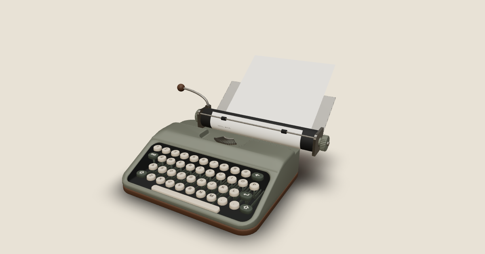

# Typewriter

An interactive 3D typewriter for the browser. Type on your keyboard or click the keys, and watch the carriage slide, the bell ring and the paper feed.

**[Try it: manuel-annabring.github.io/typewriter](https://manuel-annabring.github.io/typewriter/)**



I built this as a portfolio piece for 3D web work, and as my second three.js project. The machine is modeled in Blender, and everything that moves is driven by code.

## What you can do

- **Type.** Use your physical keyboard or click (or tap) the 3D keys. Letters appear on an A4 sheet and the carriage steps left one column at a time.
- **Hear it.** The bell rings at column 60, the margin locks at column 66, and Enter or the lever returns the carriage and feeds a line.
- **Look around.** Orbit and zoom within limits, or use **Writing view** (click the paper) to read what you type. Esc resets the view.
- **New sheet.** Pull the finished page out and wind in a fresh one.
- **Save page.** Download what you typed as a PNG.
- **Phones.** Works by touch. Desktop is the main target.

Known gap: Tab and Shift are on the keyboard but don't do anything yet.

## How it's built

**Blender to code, through a contract.** The model has a fixed set of named parts (keys, carriage, lever, paper and so on), listed in [`SPEC.md`](SPEC.md) section 5. A headless Blender script checks the names, applied transforms and origins before every export, and the code looks parts up by those names and fails loudly in development if one is missing. The generated component comes from the GLB with gltfjsx, and behavior lives in wrapper components, so re-exporting never overwrites it.

**The paper bends in a shader.** The sheet is one flat mesh. A vertex shader wraps it around the platen, over the paper bail and down onto the paper table, and lets the free part droop under its own weight. The same maths also exists in TypeScript, where it is unit tested, and I keep the two copies in sync by hand. The text on it is a canvas texture where only the new letter is drawn per keystroke.

**Sound without a library.** Eight short CC0 clips, played through the Web Audio API with round-robin variants, small random pitch and gain changes, and a limiter. One function turns "what changed in the store" into timed sound cues, so clicking a key and pressing it sound the same.

**State.** All typing state lives in one Zustand store. The carriage position and the paper feed are derived from the cursor every frame, so nothing is stored twice.

## Numbers

Measured on a production build, on an M1 Pro MacBook Pro.

| | |
|---|---|
| Frame rate | 60 fps at devicePixelRatio 2, while typing and during a carriage return |
| Model | 36k triangles, about 100 draw calls, 917 kB GLB |
| JavaScript | 77 kB gzipped for the page; the 3D scene is a lazy chunk of 296 kB gzipped |
| Sound | 85 kB of clips, fetched after the model has loaded |
| Tests | 133 unit tests (paper maths, camera paths, carriage, sound cues, key mapping, the store) |

## Run it

Needs Node 20.19+ or 22.12+ (what Vite requires).

```bash
npm install
npm run dev
```

Other commands: `npm run build`, `npm test`, `npm run typecheck`, `npm run lint`. Regenerating the model component from the GLB is `npm run gen:model`.

The Blender source is [`tools/blender/typewriter.blend`](tools/blender/typewriter.blend); the scripts that checked, exported and (for repeated parts such as the 44 keys) generated it are in [`tools/blender/`](tools/blender/).

## Built with Claude

I'm a React developer who was new to three.js, react-three-fiber and Blender, so I built this as a pair with Claude Code.

- **The process was written down.** [`SPEC.md`](SPEC.md) holds the scope and the model contract, and [`CLAUDE.md`](CLAUDE.md) holds the working rules. Work went in small slices, one per session, each ending in something I could see and test.
- **Claude wrote most of the code and edited the model.** It worked in a live Blender session through the Blender MCP server and explained each step, and every working step is saved as a re-runnable script in [`tools/blender/steps/`](tools/blender/steps/).
- **I made the design calls.** For shapes and angles (the paper path, the lever, the key levers, the typebar fan) Claude built a small interactive side-view widget and I picked the values. I also threw things away: camera moves that follow the carriage were built and removed because they didn't feel right.

## Credits

- **Sound.** CC0 recordings from Freesound by yottasounds, moodyfingers, ramsamba, knufds and keithpeter, cut and processed for this project. Authors, links and processing are in [`public/audio/LICENSES.txt`](public/audio/LICENSES.txt).
- **Fonts.** [Special Elite](https://fonts.google.com/specimen/Special+Elite) (Apache 2.0) for the typed text, and [Inter](https://rsms.me/inter/) (SIL OFL 1.1) for the key labels. The licences are in [`public/fonts/`](public/fonts/).
- **Design reference.** The overall shape and palette follow a concept sheet generated with ChatGPT ([`reference/`](reference/)). The 3D model itself was built from scratch.
- **Libraries.** three.js, react-three-fiber, drei, React, Zustand, Vite.
